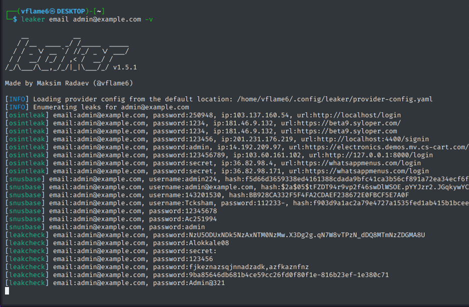

<h1 align="center">
    
    leaker
</h1>

<h4 align="center">Passive leak enumeration tool.</h4>

<p align="center">
<a href="https://github.com/vflame6/leaker/issues"></a>
<a href="https://github.com/vflame6/leaker/releases"></a>
<a href="https://t.me/vflame6"></a>
</p>

<p align="center">
  <a href="#features">Features</a> •
  <a href="#installation">Install</a> •
  <a href="#configuration">Configuration</a> •
  <a href="#running-leaker">Usage</a>
</p>

Created by Maksim Radaev/[@vflame6](https://github.com/vflame6)

---

`leaker` is a leak discovery tool that returns valid credential leaks using passive online sources. It supports searching by email, username, domain, keyword, and phone number.



---

## Features

- **17 sources** - aggregates results from multiple leak databases
- **5 search types** - email, username, domain, keyword, phone; a source runs only the types its API can search
- **Per-source summary** - after each target, a table of every source's status (ok, truncated, no key, auth, quota, ...), records fetched and kept, requests and credits; `--stats-file run.json` saves it
- **Pagination with a credit guard** - up to `--max-results` records (default 1000) in up to `--max-requests` requests (default 3; IntelX reads 10 files) per source and target, or `--all`; a notice says when results were left behind and how to get them
- **Parallel targets** - every source works through the target list at its own pace, up to `-t` targets at once (default 10)
- **Retries** - 429, 502, 503 and 504 are retried with backoff, honouring `Retry-After`; redirects are never followed, so API keys never reach another host
- **Deduplication** - removes duplicate results across sources
- **JSONL output** - structured output for pipelines (`-j`)
- **Rate limiting** - built-in per-source rate limits (disable with `-N`)
- **Proxy support** - route all traffic through a proxy (`--proxy`, or `HTTPS_PROXY` from the environment)
- **Multiple API keys** - load balancing across keys per source

### Available sources

| Source | API Key | Search Types | Pricing             |
|--------|---------|-------------|---------------------|
| [BreachDirectory](https://breachdirectory.org/) | Yes | all (auto-detect) | Free via RapidAPI   |
| [Breach House](https://breach.house/) | Yes | domain | Paid                |
| [DeHashed](https://dehashed.com/) | Yes | email, username, domain, keyword, phone | Paid                |
| [Flare](https://flare.io/)** | Yes | email, domain | ASTP licence        |
| [Have I Been Ransomed?](https://haveibeenransom.com/) | Yes | domain | Paid                |
| [Hudson Rock](https://hudsonrock.com/) | No* | email, username, domain | Free / Paid         |
| [Intelligence X](https://intelx.io/) | Yes | all | Free tier available |
| [LeakCheck](https://leakcheck.io/?ref=486555) | Yes | email, username, domain, keyword, phone | Paid                |
| [LeakRadar](https://leakradar.io/) | Yes | email, username, domain | Paid                |
| [Leak-Lookup](https://leak-lookup.com/) | Yes | email, username, domain, phone | Paid                |
| [LeakSight](https://leaksight.com/) | Yes | email, username, domain, phone | Paid                |
| [OSINTLeak](https://app.osintleak.com/auth/signup?referral_code=FLAME6) | Yes | email, username, domain, phone | Paid                |
| [ProxyNova](https://www.proxynova.com/tools/comb) | No | all | Free                |
| [Snusbase](https://snusbase.com/) | Yes | email, username, domain | Paid                |
| [SpyCloud](https://spycloud.com/)** | Yes | email, username, domain, phone | Enterprise licence  |
| [WeLeakInfo](https://weleakinfo.io/) | Yes | email, username, domain | Paid                |
| [WhiteIntel](https://whiteintel.io/) | Yes | email, username, domain | Paid                |

\* Hudson Rock works without a key through its free endpoints.
\** Built from the vendor's API documentation and not yet confirmed against a live key. If you have a licence, a report of what works (or a recorded response, keys removed) is very welcome.

`leaker sources` shows which keys are set, what each source can search and its limits.

## Usage

```shell
leaker -h
```

This will display help for the tool. Here are all the switches it supports.

```yaml
Usage: leaker <command> [flags]

  leaker is a leak discovery tool that returns valid credential leaks for emails, using passive online sources.

Flags:
  -h, --help                      Show context-sensitive help.
  -l, --list=FILE                 File with targets, one per line (- reads stdin)
  -s, --sources=online,...        Sources to use for enumeration. 
                                  online (default), all, local, or explicit source names.
  --timeout=30s                   Seconds to wait on each request before timing out
  -N, --no-rate-limit             Disable rate limiting (DANGER)
  -t, --threads=10                Targets to search at the same time
  --max-results=1000              Records to fetch per source and target at most
  --max-requests=3                Search requests per source and target at most, to spare API credits
  --all                           Fetch every record up to each API's cap (lifts --max-results, and --max-requests unless given)
  -j, --json                      Output results as JSONL (one JSON object per line)
  --no-deduplication              Disable deduplication of results across sources
  --no-filter                     Disable results filtering, include every result
  -o, --output=FILE               File to write output to
  --overwrite                     Force overwrite of existing output file
  --stats-file=FILE               Write the per-source table of every target to FILE as JSON
  -p, --provider-config=FILE      Provider config file
  --proxy=STRING                  Proxy URL for every request (default: HTTP_PROXY/HTTPS_PROXY from the environment)
  -A, --user-agent=STRING         Custom user agent
  --insecure                      Disable TLS certificate verification (use with caution)
  --db=FILE                       Path to the local SQLite cache DB
  --no-write-db                   Disable writing results to the local SQLite cache
  --version                       Print version of leaker
  -q, --quiet                     Suppress output, print results only
  -v, --verbose                   Show sources in results output
  -M, --metadata                  Include metadata fields (database) in plain output; JSON always includes them
  -D, --debug                     Enable debug mode
  --no-color                      Disable colored output
  -C, --clear-database            Clear all cached rows from the local SQLite database (confirmation required)

Commands:
  domain      Search by domain name.
  email       Search by email address.
  keyword     Search by keyword.
  phone       Search by phone number.
  username    Search by username.
  sources     List the sources with their key state, search types and limits.
  completion  Print the shell completion script.

  Run "leaker <command> --help" for more information on a command.
```

Learn more about Leaker's options here: https://github.com/vflame6/leaker/wiki/Usage

## Installation

Download an archive for your platform from [Releases](https://github.com/vflame6/leaker/releases), or install with one of:

```shell
# Homebrew, macOS and Linux
brew tap vflame6/leaker https://github.com/vflame6/leaker
brew install --cask vflame6/leaker/leaker

# Docker; the volume keeps the API keys and the local database between runs
docker run --rm -v leaker:/home/app ghcr.io/vflame6/leaker email jane@example.com

# Linux packages from Releases (not signed)
sudo dpkg -i leaker_*_linux_amd64.deb                  # Debian, Ubuntu
sudo dnf install ./leaker_*_linux_amd64.rpm            # Fedora, RHEL
sudo apk add --allow-untrusted leaker_*_linux_amd64.apk  # Alpine

# Go 1.26 or later
go install -v github.com/vflame6/leaker@latest
```

The archives and packages include shell completions for bash, zsh and fish, and a man page. After `go install`, load completions in your shell's startup file: `eval "$(leaker completion bash)"` for bash, `source <(leaker completion zsh)` for zsh, or `leaker completion fish | source` for fish.

Learn about more ways to install leaker here: https://github.com/vflame6/leaker/wiki/Install

### Configuration

`leaker` can be used right after the installation, however many sources require API keys to work. Learn more here: https://github.com/vflame6/leaker/wiki/Configuration

### Running Leaker

Learn about how to run Leaker here: https://github.com/vflame6/leaker/wiki/Running

## Contributing

Feel free to open an issue if something does not work, or if you have any ideas to improve the tool.

## Disclaimer

Read the usage disclaimer at [DISCLAIMER.md](https://github.com/vflame6/leaker/blob/main/DISCLAIMER.md).

## Star History

[](https://star-history.dera.page/#vflame6/leaker&type=date&legend=top-left)
